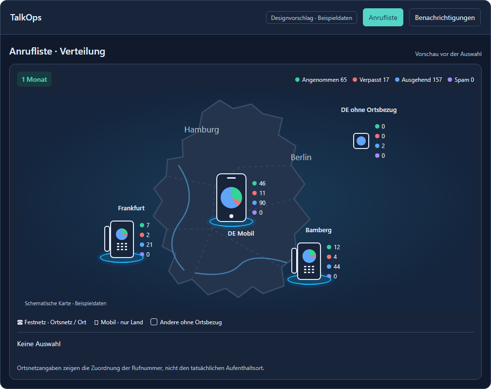
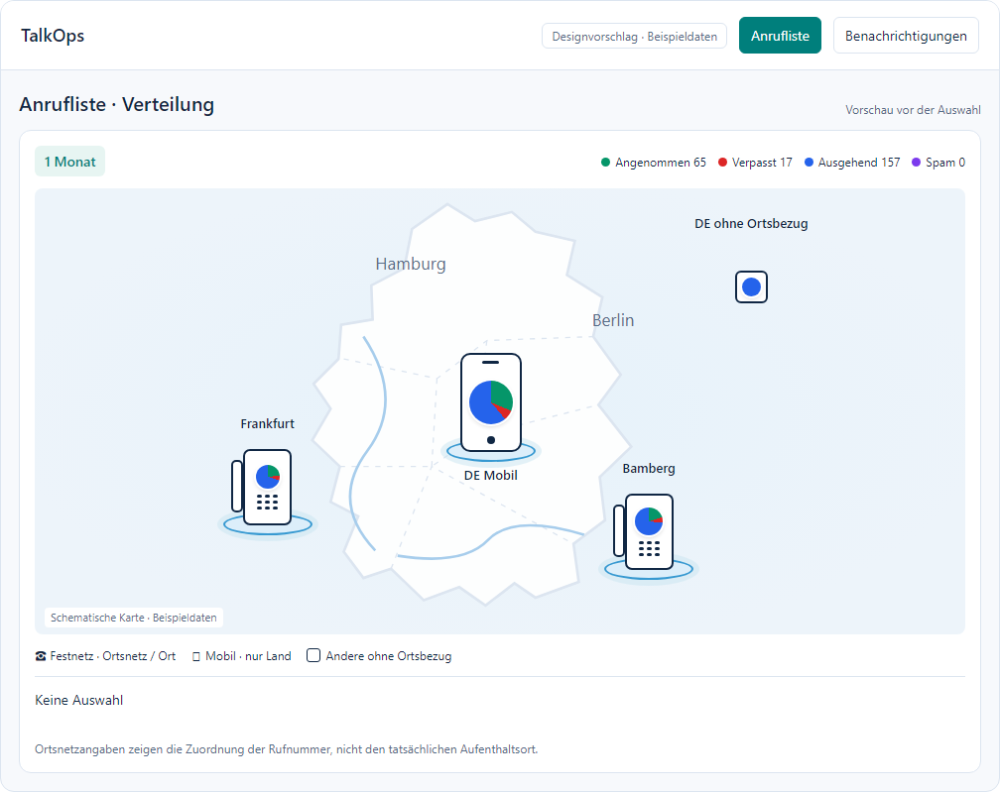
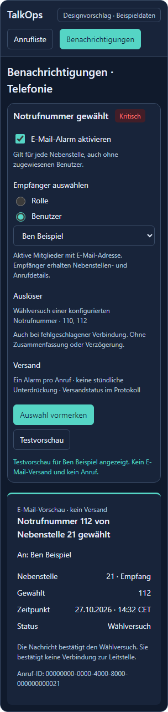

# Call map and emergency alert review

These files support the [proposal](../proposals/call-map-and-emergency-alert.md).
They do not change TalkOps. All names, statistics and email content are samples.

`call-map-emergency.html` is a local HTML fragment for the chat preview.
The chat supplies the design carousel and optional marker-size control.
The fragment makes no network requests. **Select preview** actions change
local sample state only. No setting, call or email is created.

## Devices with counts (user reference)



[Light theme preview](call-map-phone.png).

## Compact devices (dense map)



The user supplied a second reference on 2026-10-27. Local areas now use desk
phones with a handset and keypad. Mobile groups use a smartphone with a
country label. This replaces the earlier circular local markers and mobile
tile alternative. The counts hide at narrow widths to prevent overlap.

## Emergency alert settings



The alarm is disabled on the first render. The settings image shows a user
selection after local interaction. The image does not show a saved setting.

## Browser checks

Use Node.js and Playwright with an installed Chromium-compatible browser.
The test follows the module and browser overrides of the existing browser
checks. Example in PowerShell:

```powershell
$env:PLAYWRIGHT_MODULE = '<absolute path to the playwright package>'
$env:BROWSER_EXECUTABLE = '<absolute path to a Chromium-compatible browser>'
$env:MOCKUP_SCREENSHOT_DIR = '<optional task-owned screenshot directory>'
node tests/browser/call-map-emergency-mockup.mjs
```

Omit an override when the default package or browser is available. The test
checks both variants at 1024, 736 and 320 px in light and dark themes. It
checks device shapes, keypad marks, inline counts, hover, focus, Escape,
selection, touch and recipient controls. It also
checks horizontal overflow, JavaScript errors and network requests.
The test reveals each variant directly because the chat owns the carousel.
This test does not validate the future Svelte, Rust, database or SMTP changes.
